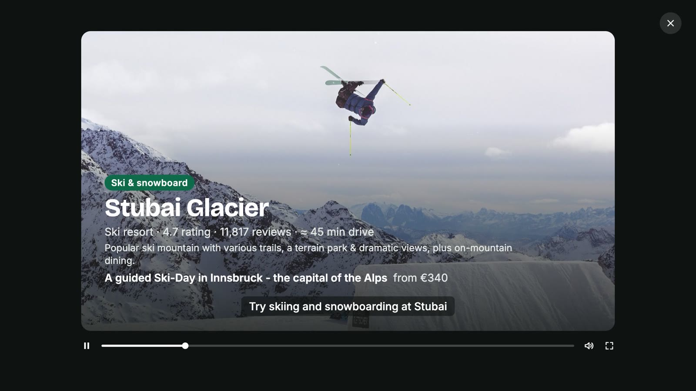
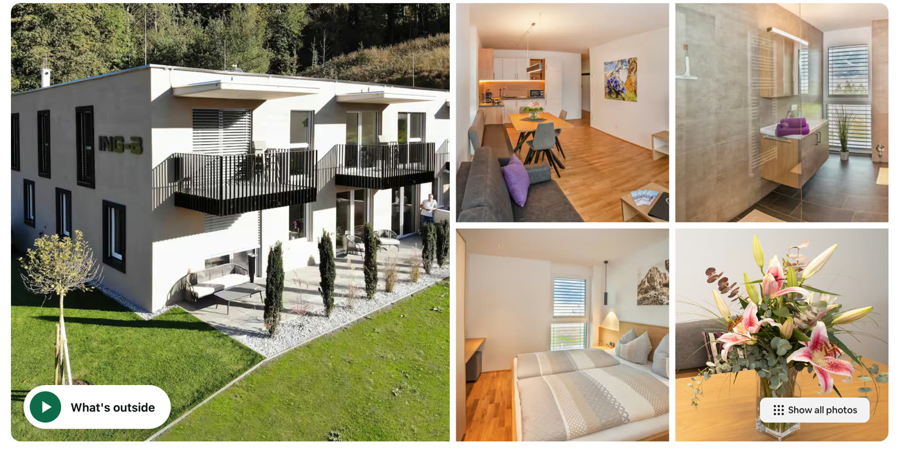
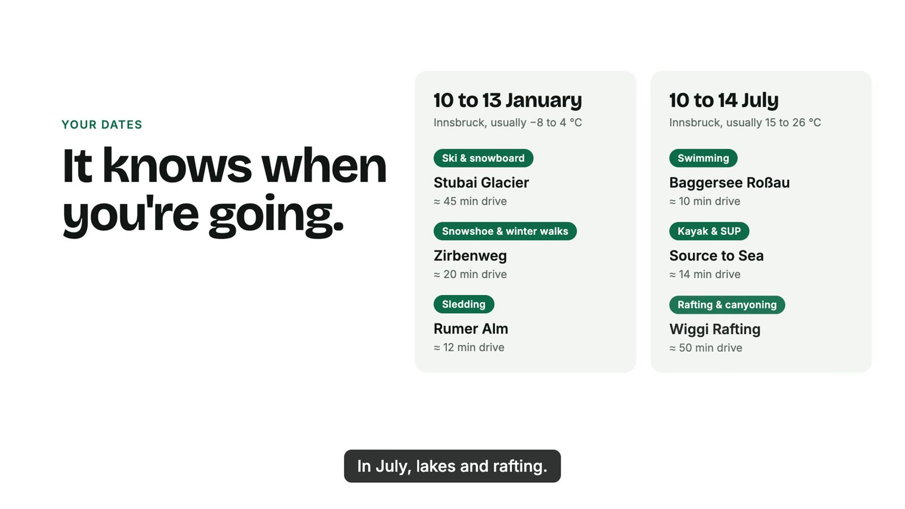
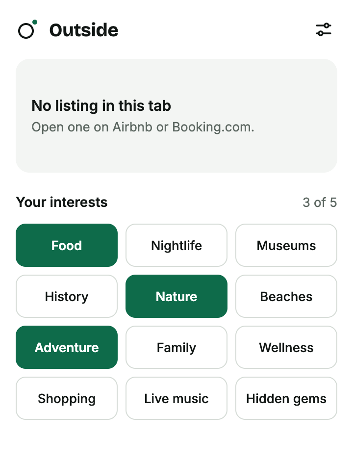
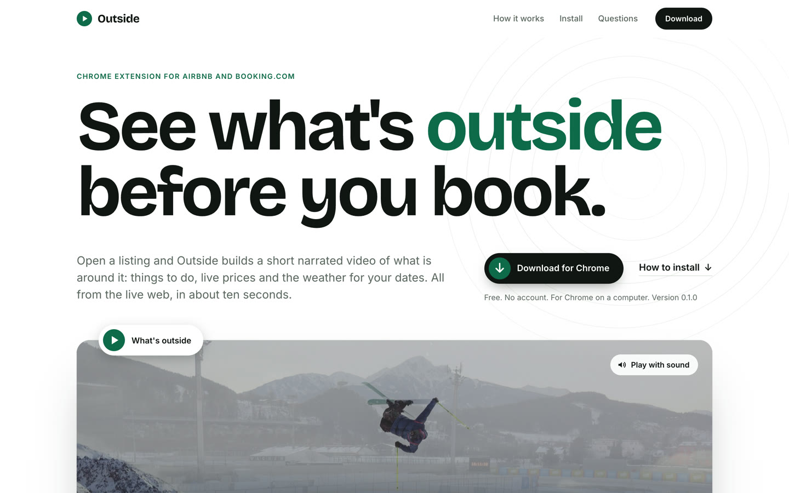

# Outside

**See what's outside before you book.** A Chrome extension that turns any Airbnb or Booking.com listing into a
short narrated video of what is around it: things to do, live prices, the weather for your dates. Built from
the live web, in about ten seconds.

[](https://outside.pgf.lv/promo/outside-promo.mp4)

**[▶ Watch the one-minute film](https://outside.pgf.lv/promo/outside-promo.mp4)** · **[Try it at outside.pgf.lv](https://outside.pgf.lv)** (download, install guide, a playable example)

Built in a day at Junction 2026 for the Context.dev challenge: *a product that reacts to the live web*.

## What it does

<table>
  <tr>
    <td width="50%"></td>
    <td width="50%"></td>
  </tr>
  <tr>
    <td valign="top"><b>On the listing.</b> A badge appears on the photos, says what it is fetching, and turns into a play button. The video plays in a full view over the page.</td>
    <td valign="top"><b>For your dates.</b> It looks up what the weather is usually like then and searches for what people do: ski areas and toboggan runs in January, lakes and rafting in July.</td>
  </tr>
</table>



Each thing to do comes with its rating, the drive, and an offer you can book with today's price. Pick up to
five interests in the popup and the video is rebuilt around them.

Every number the voice says is checked against the fact it came from, and the last scene names every source
and when it was read.

## How it works

1. **The extension** reads the listing page: the place, the dates, the photos.
2. **The server** gathers facts at that moment through [Context.dev](https://context.dev): places, ratings and
   hours from Google Maps, bookable offers from Viator and GetYourGuide, concerts from Songkick. The weather
   comes from Open-Meteo, photos of the place in season from Wikimedia Commons.
3. **Code, not a model, picks the scenes and the facts.** OpenAI writes one line per scene; a guard rejects
   any number that is not in that scene's facts.
4. **ElevenLabs** speaks it, and the extension plays it with Remotion.

Scrapes and finished videos are kept for six hours, so a second visit is instant.

<br clear="right">

## Try it

Go to **[outside.pgf.lv](https://outside.pgf.lv)**: download the zip and follow the six steps (it is loaded
through Chrome's Developer mode, as it is not in the Web Store). Then open any listing on Airbnb or Booking.com.



## Run it yourself

Node 22.9 or newer, and pnpm.

```bash
pnpm install
cp .env.example .env      # three keys: Context.dev, OpenAI, ElevenLabs
pnpm dev:server           # http://127.0.0.1:8787
pnpm build:extension      # then load apps/extension/dist/chrome-mv3 as an unpacked extension
```

`pnpm test` runs about 900 tests; `pnpm check:live` and `pnpm check:site` drive a real browser.

## What is where

| Path | What |
|---|---|
| `apps/extension` | The Chrome extension (WXT, React): badge, popup, player |
| `apps/server` | Fastify server: gathers the facts, writes and voices the script, serves the videos |
| `apps/site` | The landing page with the install guide |
| `apps/promo` | The promotional film (Remotion) and its voice-over |
| `packages/video` | The video itself: a Remotion composition |
| `packages/shared` | Types and schemas shared by all of the above |
| `deploy` | One script that puts it on a server |
| `e2e`, `scripts` | Browser checks; the release bundle |

## Read more

- [How a video is made](docs/how-it-works.md): scenes, sources, seasons, activities, limits
- [Developing](docs/development.md): setup, tests, the release, the film
- [Hosting](docs/hosting.md): `deploy/setup.sh` and what it sets up
- [Decisions and known gaps](docs/decisions.md): every call made during the build, and why
- [Which sources work](docs/sources.md) · [Design](docs/design.md) · [The original plan](docs/plan.md)

---

Outside is not affiliated with Airbnb, Booking.com, Google, Viator, GetYourGuide or Songkick. The photos in
the film and on the landing page are from Wikimedia Commons, credited on the landing page; the listing in
the screenshot is a real Airbnb page.
